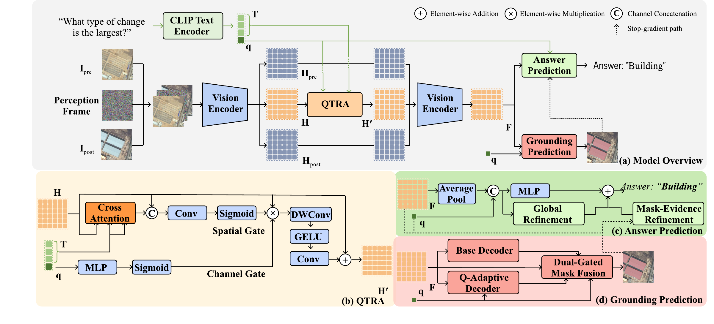

# QTRA

Implementation for **Question-Conditioned Temporal Change Encoding for Change
Detection Question Answering and Grounding in Remote Sensing**.

QTRA (Question-Conditioned Temporal Residual Adapter) conditions an intermediate
temporal change representation on a question. The QAG model predicts both an
answer and a grounding mask. A separate answer-only variant supports CDVQA.

**Code available.** Model code, stage configurations, and training and
evaluation scripts are included. The final QAG-360K checkpoint is available
under [Checkpoints](#checkpoints); the CDVQA checkpoint download is pending.
See [Attribution and licenses](#attribution-and-licenses) for the current
licensing status and third-party notices.

[Overview](#overview) · [Results](#results) · [Checkpoints](#checkpoints) ·
[Core implementation](#core-implementation) · [Installation](#installation) ·
[Data](#data) · [Training](#training) ·
[Evaluation](#standalone-evaluation) · [Code structure](#repository-layout)

## Overview



**Framework overview.** (a) QTRA conditions the middle temporal feature on the
question before the final encoder block. (b) The adapter combines token-level
spatial modulation with global question-conditioned channel modulation.
(c)–(d) The shared feature supports answer prediction and grounding, with a
stop-gradient mask-evidence path for answer refinement.

## Results

QAG-360K test results reported in the manuscript. All values are percentages;
higher is better.

| Method | Backbone | OA | AA | mIoU | oIoU |
|---|---|---:|---:|---:|---:|
| Temporal baseline | X3D-L | 77.04 | 72.42 | 43.30 | 50.11 |
| **Ours** | X3D-L | **78.00** | **73.73** | **45.50** | **52.52** |

## Checkpoints

| Model | Download | Configuration | Size |
|---|---|---|---:|
| Final QAG-360K model | [Google Drive](https://drive.google.com/file/d/1d76yj2H4zUQoAS8TsdNxjbmRfsPzguLw/view) | [qag_full.json](configs/qag_full.json) | 503.1 MiB |

Download `qtra_qag.pth` into `checkpoints/`. This model-only export preserves
all 2,054 state tensors of the final checkpoint used in the manuscript. Its
SHA256 has been verified against the uploaded file; checksums are recorded in
[SHA256SUMS](SHA256SUMS). On Linux, verify the downloaded file from the
repository root with:

```bash
(cd checkpoints && sha256sum -c ../SHA256SUMS)
```

Use the [standalone evaluation command](#standalone-evaluation) below with
`configs/qag_full.json`. The CLIP RN101 initialization file is still required
to construct the architecture. The CDVQA checkpoint is not yet published.

## Core implementation

Use these links to locate the components described in the paper. Internal
`QRA` and `calibration` names are retained for checkpoint compatibility.

| Paper component | Implementation |
|---|---|
| Perception-frame temporal encoder | [`QChange3DSharedQRAEncoderForQAG`](qtra/models/qag.py#L386) |
| QTRA: token attention, channel/spatial modulation, and residual update | [`_QRAStream2D`](qtra/models/qag.py#L201) |
| QTRA insertion into the middle temporal slice | [`SharedQRAAdapter3D`](qtra/models/qag.py#L329) |
| Global answer refinement | [`GatedResidualAnswerCalibrationHead`](qtra/models/qag.py#L133) |
| Grounding decoders and dual-gated mask fusion | [`ProgressiveMaskDecoder`](qtra/models/qag.py#L63), [`DynamicKernelMaskDecoder`](qtra/models/qag.py#L97), and [fusion forward pass](qtra/models/qag.py#L647) |
| Mask-evidence answer refinement | [`MaskGuidedResidualAnswerHead`](qtra/models/qag.py#L160) |
| Full answer-and-grounding model | [Final model class](qtra/models/qag.py#L674) · [configuration](configs/qag_full.json) |
| Temporal baseline | [`Change3D_QAG_Simple`](qtra/models/baseline.py#L67) · [configuration](configs/qag_baseline.json) |
| CDVQA answer-only variant | [`QChange3D_SharedQRACalibration_CDVQA`](qtra/models/cdvqa.py#L119) · [configuration](configs/cdvqa.json) |

## Installation

The checked environment uses Python 3.11, PyTorch 2.2.0, torchvision 0.17.0 and
CUDA 11.8. A CUDA GPU is recommended for training.

```bash
git clone https://github.com/z503z/QTRA.git
cd QTRA
conda create -n qtra python=3.11 -y
conda activate qtra
pip install torch==2.2.0 torchvision==0.17.0 --index-url https://download.pytorch.org/whl/cu118
pip install -r requirements.txt
```

Download the official initialization weights separately:

- [CLIP RN101](https://openaipublic.azureedge.net/clip/models/8fa8567bab74a42d41c5915025a8e4538c3bdbe8804a470a72f30b0d94fab599/RN101.pt).
- [Kinetics-pretrained X3D-L](https://dl.fbaipublicfiles.com/pytorchvideo/model_zoo/kinetics/X3D_L.pyth).

The CLIP file is required for architecture construction and initialization.
X3D-L initialization is required for a fresh training run, but is unnecessary
when evaluating a complete trained checkpoint. These files are not Git assets.

## Data

Obtain QAG-360K from the [dataset owners](https://github.com/like413/VisTA).
Follow their access instructions and usage conditions; this repository does
not redistribute images, question annotations or masks.

```text
QAG_ROOT/
  train/{json/Train.json,image/im1/,image/im2/,mask/}
  val/{json/Val.json,image/im1/,image/im2/,mask/}
  test/{json/Test.json,image/im1/,image/im2/,mask/}
```

Images are paired by `img_id`; grounding masks are indexed by the question's
`id`, not by `img_id`. The QAG configurations use 512 x 512 images, 23 answer
classes and 40 text tokens. Grounding uses the fixed probability threshold
0.35. No per-example threshold tuning is performed by the evaluator.

For CDVQA, obtain annotations from [CDVQA](https://github.com/YZHJessica/CDVQA)
and images from [SECOND](https://captain-whu.github.io/SCD/):

```text
CDVQA_ROOT/
  Train_images.json, Train_questions.json, Train_answers.json
  Val_images.json, Val_questions.json, Val_answers.json
  Test_images.json, Test_questions.json, Test_answers.json
  Test2_images.json, Test2_questions.json, Test2_answers.json
SECOND_ROOT/
  SECOND_train_set/{im1/,im2/}
  test/{im1/,im2/}
```

The CDVQA configuration uses 256 x 256 images and 19 answer classes. SECOND's
image-storage folder names are separate from CDVQA's annotation-defined splits.

## Training

The release trainer loads **Train and Val only**. It does not construct a
held-out evaluation loader or invoke the standalone evaluator. Training logs,
checkpoint selection and checkpoint metadata contain training and validation
results only. Evaluation of a chosen checkpoint is a separate command below.

### QAG-360K

```bash
export QAG_ROOT=/path/to/QAG-360K
export CLIP_WEIGHTS=/path/to/RN101.pt
export X3D_WEIGHTS=/path/to/X3D_L.pyth
CUDA_VISIBLE_DEVICES=0 bash scripts/train_qag.sh
```

The script runs these stages in sequence, with separate output directories:

| Configuration | Trainable components | Epochs | Learning rates |
|---|---|---:|---|
| `qag_baseline.json` | Temporal encoder and base prediction heads; CLIP frozen | 20 | 1e-4 |
| `qag_qtra.json`, first phase | QTRA and base heads | 3 | QTRA 2e-4; heads 1e-5 |
| `qag_qtra.json`, second phase | QTRA, final X3D block and base heads | 5 | QTRA 1e-4; others 1e-5 |
| `qag_global.json` | Global answer refinement | 4 | 1e-4 |
| `qag_grounding.json` | Base/dynamic mask decoders and fusion gates | 6 | 1e-4 |
| `qag_full.json` | Mask-evidence answer refinement | 4 | 1e-4 |

QAG uses AdamW, weight decay 1e-4, batch size 4, gradient accumulation 4 and
BF16 by default. Frozen encoder normalization statistics remain fixed during
QTRA adaptation. The last refinement detaches its visual, question and mask
inputs. Each stage can also be launched individually:

```bash
python train.py --config configs/qag_full.json \
  --clip-pretrained "$CLIP_WEIGHTS" \
  --train-root "$QAG_ROOT/train" --val-root "$QAG_ROOT/val" \
  --init-checkpoint outputs/qag/grounding/best_val_grounding.pth \
  --output outputs/qag/full
```

The fresh-training script uses validation-selected transitions. It is a
refactored training recipe, not a copy of the development run history; a new
training run is not guaranteed to reproduce the reported checkpoint bitwise.

### CDVQA

```bash
export CDVQA_ROOT=/path/to/CDVQA
export SECOND_ROOT=/path/to/SECOND
CUDA_VISIBLE_DEVICES=0 bash scripts/train_cdvqa.sh
```

This trains the answer-only variant independently for 50 epochs with Adam,
batch size 8 and FP32. The configuration preserves the development CDVQA
trainer's end-to-end optimization, including the CLIP text branch
(`freeze_text: false`); QAG uses a frozen CLIP text encoder. No QAG checkpoint
or grounding supervision is used by the CDVQA training script.

### Outputs and resume

- `train_log.jsonl`: epoch, phase, learning rates, training losses and validation scores.
- `val_metrics_epoch*.json`: validation metrics, including per-question-type scores.
- `best_summary.json`: validation-selected best values and epochs.
- `last.pth`, `best_val_*.pth`: resumable model/optimizer/scaler/RNG checkpoints.

`val_answer` is the mean of OA and AA; `val_grounding` is the mean of mIoU and
oIoU. `best_val_oa` and `best_val_miou` select their named metrics directly.
Metrics in JSON are fractions, not percentages. Matching checkpoint aliases
use hard links when the filesystem supports them.

Use `--resume outputs/qag/full/last.pth` instead of `--init-checkpoint` to resume
a release-format checkpoint with the same configuration. The epoch budget may
be extended with `--epochs`. Existing output directories are otherwise protected
against accidental overwrite. `--limit-train` and `--limit-val` are for smoke
checks only, not for reporting benchmark performance.

## Standalone evaluation

Download the final QAG checkpoint from [Checkpoints](#checkpoints) and save it
as `checkpoints/qtra_qag.pth`. Use the configuration matching the checkpoint
architecture. The CDVQA command requires locally available weights; its
checkpoint download is still pending.

```bash
python evaluate.py --config configs/qag_full.json \
  --checkpoint checkpoints/qtra_qag.pth --clip-pretrained "$CLIP_WEIGHTS" \
  --split Test --data-root "$QAG_ROOT/test" \
  --output outputs/evaluation/qag.json

python evaluate.py --config configs/cdvqa.json \
  --checkpoint checkpoints/qtra_cdvqa.pth --clip-pretrained "$CLIP_WEIGHTS" \
  --split Test --cdvqa-root "$CDVQA_ROOT" --second-root "$SECOND_ROOT" \
  --output outputs/evaluation/cdvqa_test1.json
```

For CDVQA Test2, change `--split` and the output filename. For CPU evaluation,
use `--device cpu --precision fp32`. The evaluator strictly checks state-dict
compatibility and records the checkpoint SHA256, precision and split. It will
not overwrite an existing result file. Debug subset runs are explicitly marked.
QAG AA and mIoU follow fixed eight-question-type averaging; oIoU aggregates pixel
counts over the selected split.

## Repository layout

```text
configs/             Explicit architecture and training-stage configurations
  qag_baseline.json  Temporal baseline
  qag_qtra.json      QTRA adaptation
  qag_global.json    Global answer refinement
  qag_grounding.json Dual-gated mask prediction
  qag_full.json      Final mask-evidence refinement
  cdvqa.json         Answer-only variant
qtra/
  models/
    qag.py           QTRA and the joint answer/grounding model
    baseline.py      Temporal baseline
    cdvqa.py         CDVQA answer-only model
    clip.py          CLIP encoder
    x3d_change3d.py  X3D configuration wrapper
  data/              Dataset readers and CLIP tokenizer
  factory.py         Model construction and checkpoint loading
  training.py        Stage freezing, losses and log records
  evaluation.py      Read-only metric evaluation
  metrics.py         Answer and grounding metric helpers
train.py             Train/validation entry point
evaluate.py          Separate chosen-checkpoint evaluation entry point
scripts/             Stage-wise launch commands
tests/               Small automated software checks (not research results)
licenses/            Preserved third-party license notices
```

Legacy internal parameter names are retained for checkpoint compatibility.
Unused experimental architectures, dataset copies, development logs and paper
drafts are not included. Multi-GPU distributed training is not implemented by
this compact release trainer; use a single visible GPU and gradient accumulation.

## Verification

```bash
python -m unittest discover -s tests -v
```

Local checks on the final QAG checkpoint verified strict loading of all 2,054
state tensors and exact equality of answer/mask logits against the development
implementation in FP32 and BF16 on nine validation examples covering all eight
canonical question types (including the ratio-type alias). These are equivalence
checks, not a fresh full-dataset benchmark or a full retraining experiment.

## Attribution and licenses

Please see [THIRD_PARTY_NOTICES.md](THIRD_PARTY_NOTICES.md). This work builds on
[Change3D](https://github.com/zhuduowang/Change3D),
[VisTA/QAG-360K](https://github.com/like413/VisTA),
[CLIP](https://github.com/openai/CLIP),
[CRIS](https://github.com/DerrickWang005/CRIS.pytorch) and
[PyTorchVideo](https://github.com/facebookresearch/pytorchvideo).
Third-party license texts are retained; no blanket MIT license is asserted over
the mixed codebase. Dataset and pretrained-weight terms remain separate.
